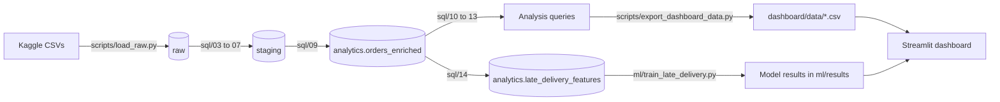

# Olist E-Commerce Analytics

I wanted a project that used the SQL and machine learning I learned on Kaggle on something messier than a clean practice dataset. Olist is a Brazilian marketplace that published about 100k real orders, split across nine tables. I loaded them into BigQuery, cleaned them into one row per order, answered some business questions with SQL, built a small dashboard, and trained a model to predict which orders will arrive late.

The most useful thing I learned was how much of the work is checking that the numbers are right. A few of those checks changed my results, and they are listed in [Data quality](#data-quality-and-the-decisions-i-made).

## Data

[Olist Brazilian E-Commerce Public Dataset](https://www.kaggle.com/datasets/olistbr/brazilian-ecommerce) from Kaggle: 9 CSV files, 99,441 orders from 2016 to 2018. The CSVs aren't in this repo. Download them from Kaggle and put them in a `data/` folder.

## How it fits together



Everything between the raw tables and the dashboard is SQL, in numbered files under `sql/` so you can see the order they run in.

## Running it yourself

You need a Google Cloud project with BigQuery turned on, and a local login:

```
gcloud auth application-default login
```

Then:

```
pip install -r requirements.txt
python scripts/load_raw.py        # loads the nine CSVs into the raw dataset
python scripts/rebuild.py         # builds staging and analytics tables, then checks them
```

Run `sql/00_setup.sql` once first to create the `raw`, `staging` and `analytics` datasets. The project ID in the SQL files is mine (`olist-analytics-510317`), so search and replace it with yours.

`rebuild.py` finishes by checking the final table against totals I verified by hand (99,441 orders and 13,591,643.70 in item revenue). If they don't match, it stops with an error instead of quietly producing wrong numbers.

To produce the analysis outputs and open the dashboard:

```
python scripts/export_dashboard_data.py
python ml/train_late_delivery.py
streamlit run app/streamlit_app.py
```

There's also a small test that runs the ML code on made-up data, so it works without BigQuery: `python tests/test_ml_smoke.py`.

BigQuery's free sandbox deletes tables after 60 days, so rerun the load and rebuild if they've disappeared.

## What the analysis found

Revenue here means item price, without freight, and leaves out canceled or unavailable orders. Trends cover Jan 2017 to Aug 2018. Before and after that, the dataset has too few orders to say anything.

- **Revenue grew through 2017, then leveled off.** Total item revenue was 13.45M across 97,905 orders, about 137 per order. November 2017 was the best month at roughly 1.00M. Through 2018 it stayed between 0.84M and 0.99M a month. The biggest categories were health_beauty (1.26M), watches_gifts (1.20M) and bed_bath_table (1.04M).
- **Almost nobody orders twice.** Only 3.04% of customers (2,887 of 94,983) came back for a second order. In the larger monthly cohorts, under 1% ordered again the following month.
- **A small group of sellers earns most of the money.** The top 10% of sellers bring in 67.5% of revenue. The bottom half share 3.3%.
- **Late deliveries wreck reviews.** Late orders average a 2.27 review score, against 4.29 for on-time orders. 62% of late orders get a score of 2 or lower, compared with 9% of on-time ones.
- **Lateness clusters in certain places and months.** Overall, 6.77% of delivered orders were late. By month it peaked at 19.0% in March 2018 and fell to 1.2% by June. By state, Alagoas was worst at 21.4% (median delivery of 22 days), against 4.5% and a 7-day median in Sao Paulo.

All of these come from `sql/10` to `sql/13`, and the exported tables are in `dashboard/data/`.

## Predicting late deliveries

The question: at the moment someone places an order, can we tell whether it will arrive late?

How I set it up:

- **Features only from purchase time.** Distance between seller and customer, the estimated delivery days Olist showed the customer, item weight and size, order value, payment type, state, and time of purchase. I left out review scores and anything from the shipping process, since those wouldn't be known yet and would give the answer away.
- **Split by time, not at random.** The earliest 80% of orders train the model and the latest 20% test it, which is closer to how it would be used. A random split lets the model peek at the future.
- **Two simple baselines to beat.** One always predicts the average late rate. The other uses only the estimated delivery days.
- **PR AUC as the main score**, because only about 7% of orders are late and accuracy would look great even for a useless model. I also check how well it does when it flags only its riskiest 10% of orders.
- **Model choice by cross-validation.** I picked the best model using the training period only, and report test results for all of them.

### Results

Trained on 77,176 orders up to 26 May 2018 and tested on the 19,294 after that. The late rate dropped from 7.6% in training to 3.5% in testing.

| Model | Cross-validated PR AUC | Test PR AUC | Test ROC AUC | Late orders caught in riskiest 10% | Lift |
|---|---|---|---|---|---|
| Always predict the average late rate | 0.083 | 0.035 | 0.500 | 1.5% | 0.1x |
| Logistic regression, estimated days only | 0.078 | 0.120 | 0.750 | 40.9% | 4.1x |
| Logistic regression, all features (picked by CV) | 0.162 | 0.076 | 0.707 | 22.7% | 2.3x |
| Gradient boosting, all features | 0.148 | 0.066 | 0.695 | 21.2% | 2.1x |

The honest takeaway is that the fancier models did not win. Using every feature roughly doubled the cross-validation score, but on the later test period the one-feature model was better than both of them.

My best guess is that conditions changed. The training period includes the big delay spike from Nov 2017 to Mar 2018, and the test period is calm. The all-features model expects far more late orders in some northeastern states than actually happened (it predicted 24% for Alagoas against 6% real). I haven't proven that's the cause. The per-state numbers are in `ml/results/state_error_analysis.csv` if you want to check.

Even the simple rule is useful, though. Flagging the 10% of orders with the shortest estimated delivery windows catches about 41% of the late ones, roughly four times better than picking at random.

If this were going to production I would retrain on a rolling window, watch the late rate for drift, and look for features that describe the delivery network (carrier capacity, regional delays) rather than seasonality.

Output files are in `ml/results/`: `metrics.json`, `model_comparison.csv`, `decile_table.csv`, `state_error_analysis.csv`, `permutation_importance.csv` and `pr_curves.png`.

## Data quality and the decisions I made

| What I found | What I did |
|---|---|
| Joining items and payments directly inflated revenue by about 4.5% (13.59M became 14.21M), because orders with several items or payments got duplicated | Summarized items and payments to one row per order before joining. Revenue now matches the plain sum exactly. |
| 547 orders have more than one review | Averaged the scores to one per order and kept a review count. |
| 8 delivered orders have no delivery date | Kept them, flagged with `has_valid_delivery`, and left them out of delivery-time numbers. I didn't fill in dates. |
| 775 orders have no items (mostly canceled or unavailable) | Kept, with `has_items = FALSE`. |
| 1 delivered order has no payment record | Kept, with `has_payment_record = FALSE`. |
| 610 products have no category | Labeled `unknown` and left the other fields empty. |
| 2 categories are missing from the translation table | Translated by hand, with a comment in the SQL. |
| 2016 and Sep 2018 have almost no orders (2, 290, 0 and 1 in Sep to Dec 2016, and 1 in Sep 2018) | Monthly trends only use months with 500+ orders. Without this, growth rates came out in the thousands of percent. |
| Cohorts ran into the end of the data | Retention stops at the last full month, so the final cohorts don't show a fake drop to zero. |
| `customer_id` changes with every order, so it can't identify a returning customer | Used `customer_unique_id` for anything about repeat behavior. Using the wrong one would show a 0% repeat rate. |
| Delivery time is heavily skewed (median 10 days, 95th percentile 29, max 210) | Report the median and percentiles instead of the average. |

## Project layout

```
sql/        numbered SQL scripts: setup, profiling, staging, analytics, analysis, ML features
scripts/    load_raw.py, rebuild.py, export_dashboard_data.py
ml/         train_late_delivery.py and its results
app/        Streamlit dashboard
tests/      smoke test for the ML code, on synthetic data
dashboard/  exported CSVs the dashboard reads
```

## Possible next steps

- Put the dashboard online with Streamlit Community Cloud.
- Schedule the rebuild so the tables don't expire.
- Try the delivery-network features mentioned above and see whether they hold up over time.
