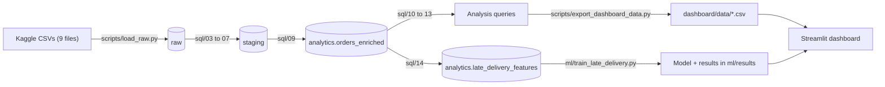

# Olist E-Commerce Analytics

An end-to-end SQL and machine learning project on the Olist Brazilian e-commerce dataset, built on Google BigQuery. The goal: turn nine messy relational tables into a clean, trustworthy, one-row-per-order table that supports business analysis and a prediction model.

**Status:** data engineering layer complete and verified. SQL analysis, dashboard and late-delivery model are written and tested on synthetic data. Real-data results are produced by running the steps under [Run the analysis](#run-the-analysis).

## Data

[Olist Brazilian E-Commerce Public Dataset](https://www.kaggle.com/datasets/olistbr/brazilian-ecommerce) from Kaggle: 9 CSV files, 99,441 orders. The raw CSVs are not stored in this repo; download them from Kaggle and load them into a `raw` dataset in BigQuery.

## Pipeline



All transformations are SQL scripts in `sql/`, numbered in run order.

## Rebuild

The project can be recreated from this repo plus the Kaggle download (requires a Google Cloud project with BigQuery and a local login via `gcloud auth application-default login`).

1. Download the [dataset](https://www.kaggle.com/datasets/olistbr/brazilian-ecommerce) from Kaggle and place the 9 CSV files in `data/`.
2. Run the pipeline:

```
pip install -r requirements.txt
python scripts/load_raw.py
python scripts/rebuild.py
```

`load_raw.py` loads the nine CSVs into the `raw` dataset. `rebuild.py` runs the staging and analytics SQL in order, then checks the final table against the verified totals (99,441 orders, 13,591,643.70 item revenue) and stops with an error if they don't match.

Note: `sql/00_setup.sql` creates the `raw`, `staging`, and `analytics` datasets and has to be run once before the first load. `sql/01a_raw_column_fixes.sql` is only needed for tables uploaded by hand through the BigQuery console.

## Run the analysis

After the rebuild above has passed:

```
python scripts/export_dashboard_data.py     # runs the analysis queries, writes dashboard/data/*.csv
python ml/train_late_delivery.py            # builds the feature table, trains, writes ml/results/
streamlit run app/streamlit_app.py          # opens the dashboard
python tests/test_ml_smoke.py               # optional: checks the ML code on synthetic data, no BigQuery needed
```

What each piece answers:

| Script | Question |
|---|---|
| `sql/10_analysis_revenue_trends.sql` | How does revenue move month to month, and which categories and states drive it? |
| `sql/11_analysis_cohort_retention.sql` | What share of customers come back, cohort by cohort? |
| `sql/12_analysis_delivery_performance.sql` | Where and when are deliveries late, and does lateness hurt review scores? |
| `sql/13_analysis_seller_performance.sql` | Which sellers drive revenue, and how concentrated is it? |
| `sql/14_ml_late_delivery_features.sql` | What is known at purchase time that could predict a late delivery? |

## Late-delivery model

Goal: flag orders likely to arrive late at the moment they are placed.

- **Features** use only information available at purchase time (seller to customer distance, estimated delivery days, weight and size, order value, payment, location, timing). Review scores, carrier dates and actual delivery time are excluded on purpose because they would leak the answer.
- **Split** is by time: the earliest 80 percent of orders train the model and the latest 20 percent test it. A random split would let the model see the future.
- **Baselines**: always predicting the training late rate, and a one-feature model on the estimated delivery days. The full models have to beat both.
- **Metric**: PR AUC, because late orders are a minority. Precision and recall for the riskiest 10 percent of orders show how it would work as a review queue.
- **Error analysis**: calibration by risk decile and by state, plus permutation feature importance.

Output files are in `ml/results/` (`metrics.json`, `model_comparison.csv`, `decile_table.csv`, `state_error_analysis.csv`, `permutation_importance.csv`, `pr_curves.png`).

## Project structure

```
sql/        numbered SQL scripts (setup, profiling, staging, analytics, analysis, ML features)
scripts/    load_raw.py, rebuild.py, export_dashboard_data.py
ml/         train_late_delivery.py and its results
app/        Streamlit dashboard
tests/      smoke test for the ML code (synthetic data)
dashboard/  exported CSVs the dashboard reads
```

## Data quality findings and decisions

| Finding | Decision |
|---|---|
| 8 delivered orders have no delivery date | Kept; flagged with `has_valid_delivery`; excluded from delivery-time metrics. Dates were not filled in. |
| 551 extra rows in `order_reviews` (547 orders have more than one review) | Averaged review scores to one row per order and kept `n_reviews`. |
| Joining items and payments directly inflated item revenue by about 4.5% (13.59M to 14.21M) | Summarized items and payments to one row per order before joining; joined revenue now matches the direct sum exactly. |
| 775 orders have no items (mostly unavailable or canceled) | Kept with `has_items = FALSE`. |
| 610 products have no category or photo count | Labeled `unknown`, left other fields NULL. |
| 2 categories missing from the translation table | Mapped by hand, with a comment in the SQL. |
| 1 delivered order has no payment record | Kept; flagged with `has_payment_record = FALSE`. |
| Delivery time is skewed (median 10 days, 95th percentile 29, max 210) | Report median and percentiles instead of the mean. |

## Roadmap

- [x] Raw load, profiling, staging, analytics table
- [x] One-command rebuild script
- [x] SQL analysis: revenue trends, cohort retention, delivery and seller performance
- [x] Dashboard (Streamlit, reads exported CSVs)
- [x] Late-delivery model code with baselines, time-based validation and error analysis
- [ ] Run on the full data, then add the headline findings and model results to this README
