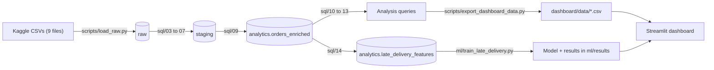

# Olist E-Commerce Analytics

An end-to-end SQL and machine learning project on the Olist Brazilian e-commerce dataset, built on Google BigQuery. The goal: turn nine messy relational tables into a clean, trustworthy, one-row-per-order table that supports business analysis and a prediction model.

**Status:** complete. Pipeline, SQL analysis, dashboard and late-delivery model are built, and results are in `dashboard/data/` and `ml/results/`. See [Findings](#findings) and [Late-delivery model](#late-delivery-model).

## Data

[Olist Brazilian E-Commerce Public Dataset](https://www.kaggle.com/datasets/olistbr/brazilian-ecommerce) from Kaggle: 9 CSV files, 99,441 orders. The raw CSVs are not stored in this repo; download them from Kaggle and load them into a `raw` dataset in BigQuery.

## Pipeline



All transformations are SQL scripts in `sql/`, numbered in run order.

## Rebuild

The project can be recreated from this repo plus the Kaggle download (requires a Google Cloud project with BigQuery and a local login via `gcloud auth application-default login`).

1. Download the [dataset](https://www.kaggle.com/datasets/olistbr/brazilian-ecommerce) from Kaggle and place the 9 CSV files in `data/`.
2. Run the pipeline:

```
pip install -r requirements.txt
python scripts/load_raw.py
python scripts/rebuild.py
```

`load_raw.py` loads the nine CSVs into the `raw` dataset. `rebuild.py` runs the staging and analytics SQL in order, then checks the final table against the verified totals (99,441 orders, 13,591,643.70 item revenue) and stops with an error if they don't match.

Note: `sql/00_setup.sql` creates the `raw`, `staging`, and `analytics` datasets and has to be run once before the first load. `sql/01a_raw_column_fixes.sql` is only needed for tables uploaded by hand through the BigQuery console.

## Run the analysis

After the rebuild above has passed:

```
python scripts/export_dashboard_data.py     # runs the analysis queries, writes dashboard/data/*.csv
python ml/train_late_delivery.py            # builds the feature table, trains, writes ml/results/
streamlit run app/streamlit_app.py          # opens the dashboard
python tests/test_ml_smoke.py               # optional: checks the ML code on synthetic data, no BigQuery needed
```

What each piece answers:

| Script | Question |
|---|---|
| `sql/10_analysis_revenue_trends.sql` | How does revenue move month to month, and which categories and states drive it? |
| `sql/11_analysis_cohort_retention.sql` | What share of customers come back, cohort by cohort? |
| `sql/12_analysis_delivery_performance.sql` | Where and when are deliveries late, and does lateness hurt review scores? |
| `sql/13_analysis_seller_performance.sql` | Which sellers drive revenue, and how concentrated is it? |
| `sql/14_ml_late_delivery_features.sql` | What is known at purchase time that could predict a late delivery? |

## Findings

All figures come from the queries in `sql/10` to `sql/13` (exported to `dashboard/data/`). Revenue means item price, excluding freight and canceled or unavailable orders. Trend figures cover Jan 2017 to Aug 2018, because 2016 and Sep 2018 have too few orders to read (see the data quality table).

- **Revenue grew through 2017 and then held at a plateau.** Item revenue was 13.45M over 97,905 orders (average order 137.37). November 2017 was the peak at about 1.00M, up 52.1% on October. In Jan to Aug 2018 monthly revenue stayed between 0.84M and 0.99M, and August 2018 was 1.49x August 2017. The biggest categories were health_beauty (1.26M), watches_gifts (1.20M) and bed_bath_table (1.04M).
- **Few customers come back.** Only 3.04% of customers (2,887 of 94,983) ordered more than once. In cohorts of 1,000+ customers, between 0.22% and 0.71% ordered again in the following month.
- **Revenue is concentrated in a small group of sellers.** The top 10% of sellers earn 67.5% of revenue and the top 20% earn 82.6%. The bottom half together earn 3.3%.
- **Late delivery wrecks reviews.** Orders delivered late average a 2.27 review score against 4.29 for on-time orders, and 62.4% of late orders get a low score (2 or below) against 9.2% of on-time orders.
- **Lateness is concentrated in time and place.** Overall 6.77% of delivered orders were late, but the monthly rate hit 12.4% in Nov 2017, 14.1% in Feb 2018 and 19.0% in Mar 2018, then fell to 1.2% by Jun 2018. By state, Alagoas had the highest late rate at 21.4% (median delivery 22 days), then Maranhao at 17.4% and Sergipe at 15.2%, against 4.5% and a 7-day median in Sao Paulo.

## Late-delivery model

Goal: flag orders likely to arrive late at the moment they are placed.

- **Features** use only information available at purchase time (seller to customer distance, estimated delivery days, weight and size, order value, payment, location, timing). Review scores, carrier dates and actual delivery time are excluded on purpose because they would leak the answer.
- **Split** is by time: the earliest 80 percent of orders train the model and the latest 20 percent test it. A random split would let the model see the future.
- **Baselines**: always predicting the training late rate, and a one-feature model on the estimated delivery days. The full models have to beat both.
- **Metric**: PR AUC, because late orders are a minority. Precision and recall for the riskiest 10 percent of orders show how it would work as a review queue.
- **Error analysis**: calibration by risk decile and by state, plus permutation feature importance.

Output files are in `ml/results/` (`metrics.json`, `model_comparison.csv`, `decile_table.csv`, `state_error_analysis.csv`, `permutation_importance.csv`, `pr_curves.png`).

### Results

Trained on 77,176 orders up to 26 May 2018 and tested on the 19,294 orders after that. The late rate fell from 7.6% in the training period to 3.5% in the test period.

| Model | Cross-validated PR AUC (training period) | Test PR AUC | Test ROC AUC | Late orders caught in riskiest 10% | Lift |
|---|---|---|---|---|---|
| Always predict the training late rate | 0.083 | 0.035 | 0.500 | 1.5% | 0.1x |
| Logistic regression, estimated delivery days only | 0.078 | 0.120 | 0.750 | 40.9% | 4.1x |
| Logistic regression, all features (selected) | 0.162 | 0.076 | 0.707 | 22.7% | 2.3x |
| Gradient boosting, all features | 0.149 | 0.065 | 0.696 | 20.5% | 2.0x |

What this shows:

- **The richer models win in validation but lose on later data.** Inside the training period, using all features roughly doubles the cross-validated PR AUC compared with the baselines. On the final held-out period the one-feature model beats them.
- **A simple rule is genuinely useful.** Flagging the 10% of orders with the shortest estimated delivery windows catches 41% of late orders, 4.1 times better than flagging at random.
- **Likely reason (a hypothesis, not proven here): conditions changed.** The training period contains the Nov 2017 to Mar 2018 delay spike and the test period is calm. The all-features model over-predicts lateness in test for several northeastern states (for example it predicts 24% for Alagoas against 6% actual), which fits that explanation. `ml/results/state_error_analysis.csv` has the full breakdown.
- **Model choice used validation data only.** The all-features logistic regression was selected by its cross-validation score alone. Test results are reported for every model, and no hyperparameters were tuned against the test period.

Next steps if this were going to production: retrain on a rolling window, monitor the late rate for drift, and test whether features that describe the delivery network (carrier capacity, regional delays) generalize better than seasonality and location.

## Project structure

```
sql/        numbered SQL scripts (setup, profiling, staging, analytics, analysis, ML features)
scripts/    load_raw.py, rebuild.py, export_dashboard_data.py
ml/         train_late_delivery.py and its results
app/        Streamlit dashboard
tests/      smoke test for the ML code (synthetic data)
dashboard/  exported CSVs the dashboard reads
```

## Data quality findings and decisions

| Finding | Decision |
|---|---|
| 8 delivered orders have no delivery date | Kept; flagged with `has_valid_delivery`; excluded from delivery-time metrics. Dates were not filled in. |
| 551 extra rows in `order_reviews` (547 orders have more than one review) | Averaged review scores to one row per order and kept `n_reviews`. |
| Joining items and payments directly inflated item revenue by about 4.5% (13.59M to 14.21M) | Summarized items and payments to one row per order before joining; joined revenue now matches the direct sum exactly. |
| 775 orders have no items (mostly unavailable or canceled) | Kept with `has_items = FALSE`. |
| 610 products have no category or photo count | Labeled `unknown`, left other fields NULL. |
| 2 categories missing from the translation table | Mapped by hand, with a comment in the SQL. |
| 1 delivered order has no payment record | Kept; flagged with `has_payment_record = FALSE`. |
| 2016 and Sep 2018 have almost no orders (2, 290, 0 and 1 orders in Sep, Oct, Nov and Dec 2016, and 1 in Sep 2018) | Monthly trends only use months with at least 500 orders. Without this rule, growth rates came out in the thousands of percent. |
| Cohorts ran into the end of the data (the month after Aug 2018 is nearly empty) | Retention only counts activity up to the last month with 500+ orders, so cohorts do not show a fake drop to zero. |
| Delivery time is skewed (median 10 days, 95th percentile 29, max 210) | Report median and percentiles instead of the mean. |

## Roadmap

- [x] Raw load, profiling, staging, analytics table
- [x] One-command rebuild script
- [x] SQL analysis: revenue trends, cohort retention, delivery and seller performance
- [x] Dashboard (Streamlit, reads exported CSVs)
- [x] Late-delivery model code with baselines, time-based validation and error analysis
- [x] Run on the full data and add the findings and model results to this README

## Provenance of the committed results

The files in `dashboard/data/` and `ml/results/` were generated by running this repo's SQL on the full Olist data in a local DuckDB engine (the BigQuery SQL translated with `sqlglot`), because BigQuery could not be reached from the environment that built them. Before trusting that setup, the same pipeline was run locally and reproduced the BigQuery checks exactly (99,441 orders, 13,591,643.70 item revenue, 775 orders without items, 96,470 valid deliveries, 6,534 late). To regenerate everything against BigQuery, run `python scripts/export_dashboard_data.py` and `python ml/train_late_delivery.py`. Small differences are possible, because BigQuery's `APPROX_QUANTILES` is approximate, its distance function uses a spheroid where the local run used a sphere, and its weekday numbering starts at 1 where DuckDB's starts at 0.
